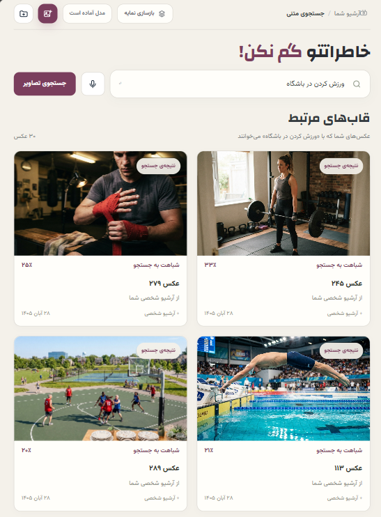

# Semantic Photo Search

Semantic text-to-image search over a personal image gallery (~300 photos).  
Describe what you remember — find the closest matching photos.

---

## Table of Contents

- [Features](#features)
- [Tech Stack](#tech-stack)
- [Project Structure](#project-structure)
- [Running the Application](#running-the-application)

---

## Features

- **Text-to-image search** in Persian & English
- **Vector indexing** with FAISS for fast search (millisecond-level)
- **CLI** for batch indexing and search
- **Automated evaluation** with standard metrics (Recall@K, mAP, nDCG, MRR)
- **Modular architecture** — swap models by changing two lines in `config.py`



---

## Tech Stack

| Layer | Technology | Role |
|---|---|---|
| Embedding Model | Jina CLIP v2 | Converts multilingual text and images into a shared 1,024-dimensional vector space |
| Vector Index | FAISS (`IndexFlatIP`) | Cosine similarity search |
| Framework | PyTorch + Hugging Face Transformers | Model loading and inference |
| UI | React, HTML, and CSS | Web frontend |
| Testing | pytest | Unit tests |

---

## Project Structure

```text
app/
  backend/
    api.py              # FastAPI HTTP API
    search_service.py   # Application-facing search service
  frontend/
    index.html
    package.json        
    vite.config.js
    src/
      App.jsx
      main.jsx
      styles.css
evaluation/             # model comparison
  models.json
  runner.py
  metrics.py
src/
  config.py            
  search.py             # Embedding, indexing, and retrieval core
cli.py                  # Command-line interface
evaluate.py             
data/
  images/              
tests/
```

## Running the Application

### One-time setup

Install Conda and Node.js (which includes npm). If you do not already have a
Python environment for the app, create one in PowerShell:

```powershell
conda create -n dl_env python=3.11 -y
conda activate dl_env
```

Install a PyTorch build that matches your hardware using the
[PyTorch installation selector](https://pytorch.org/get-started/locally/),
then install the remaining project dependencies:

```powershell
python -m pip install -r requirements.txt
```

Add your photos to `data/images/`.

### Start

From the repository root, with the Python environment active and Node.js/npm
available on your `PATH`, run:

```powershell
python run_app.py
```

The runner starts the FastAPI backend and Vite frontend together, installs the
frontend packages on first run if needed, and stops both processes when you
press `Ctrl+C`. It uses the active Python environment; it does not activate
Conda for you.

By default, the app is available at `http://127.0.0.1:5173` and the backend
health endpoint at `http://127.0.0.1:8000/api/health`. To change the frontend
port or disable backend auto-reload, pass runner options, for example:

```powershell
python run_app.py --frontend-port 5174 --no-reload
```

The backend uses Jina CLIP v2 on CUDA to index and search the local image
gallery. The gallery appears from the local image folder immediately; the
first search loads Jina and builds the FAISS index, which can take several
minutes. Later searches reuse the saved index at `data/index.faiss`.

Model comparison is separate from the application and runs in the terminal.
Configure candidates in `evaluation/models.json`, then run
`python evaluate.py --device cpu` from the repository root. See
`evaluation/README.md` for metrics, outputs, and current limitations.
